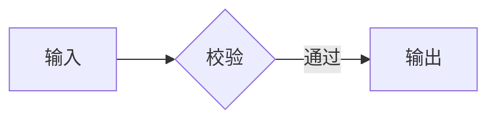

# 真实文档验收

正文覆盖中文、行内代码 `vutex render`、Unicode 箭头 → ← ↔ ⇒ ⇐、数学符号 ∑ ∞ ≤ ≥ ∈ ± ≠ ≈ √ 与单色 emoji ✔ ★ ☀。

## 代码围栏

```rust
// 中文注释：渲染入口
fn render() -> usize { 42 }
```

## Mermaid 图



## TikZ 图

```tikz
\begin{tikzpicture}
\draw[blue] (0,0) -- (2,0) node[above] {峰值} -- (3,1);
\fill[red] (0,0) rectangle (1,1);
\end{tikzpicture}
```

## SVG 图


